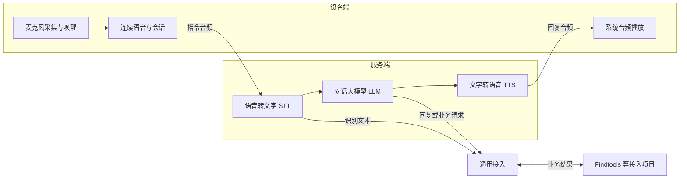

# 语音平台总体架构设计

- 更新日期为 2026-11-04。
- 已确定设备端与服务端分离、模型可替换、一语即达及第一阶段选型方向。
- 当前实现为设计文档，运行代码和模型接入待开发。
- 返回[开发者设计索引](index.md)。

## 目标与约束

| 编号 | 已确定设计 | 预期结果 |
| --- | --- | --- |
| V-001 | 独立运行 | 语音平台可独立启动、停止、重启和调试 |
| V-002 | 通用接入 | Findtools 和其他项目通过统一接口使用语音及对话能力，业务动作由接入项目执行 |
| V-003 | 调试隔离 | 语音调试期间，正式 Findtools 的查询和设备操作保持可用 |
| V-004 | 联合部署 | 支持与 Findtools 一起部署，各服务分别运行 |
| V-005 | 子项目自包含 | voice 拥有自己的依赖、配置和入口，可单独迁出 |
| V-006 | 文档归属 | 两套语音文档库均保存在 voice 内 |
| V-007 | 设备端与服务端分离 | PC、树莓派、ESP32 可通过共同接入约定连接服务端 |
| V-008 | 模型可替换 | 语音转文字、文字转语音、对话大模型分别具备可扩展接口 |
| V-009 | 本地与在线模型 | 模型接口覆盖两类部署方式，首版可只实现部分提供方 |
| V-010 | 一语即达 | 唤醒词后直接连续说内容，设备完整保留并提交指令，无需等待提示或再次开口 |
| V-011 | 第一阶段 | Windows 10 系统麦克风输入、系统音频输出和唤醒，在线豆包语音识别及 DeepSeek 对话 |

## 总体架构

- 设备端负责现场音频输入、唤醒、连续语音保留和回复播放。
- 服务端负责语音识别、对话处理和语音合成，三类模型分别替换。
- 通用接入维护设备与服务端的契约，以及外部业务项目的接口。
- 部署与调试贯穿两端，支持同机联调和后续分机部署。
- Findtools 的货位选择、查询和亮灯由 Findtools 处理，模型业务请求的接入规则另行确定。

## 模块划分

| 模块 | 边界 | 设计入口 |
| --- | --- | --- |
| 设备端 | PC、树莓派、ESP32 的音频输入输出、唤醒和连续语音交互 | [设备端](设备端.md) |
| 服务端 | STT、TTS、LLM 的统一能力和会话处理 | [服务端](服务端.md) |
| 通用接入 | 端间接口、会话关联和外部项目接入 | [通用接入](通用接入.md) |
| 部署与调试 | 各端独立运行、配置、联合部署和测试隔离 | [部署与调试](部署与调试.md) |

## 第一阶段与扩展范围

| 能力 | 第一阶段 | 后续扩展 |
| --- | --- | --- |
| 输入设备 | 当前 Windows 10 电脑的系统麦克风 | 树莓派、ESP32 等设备适配 |
| 输出设备 | Windows 系统音频输出设备，具体选择方式待实现 | 各终端扬声器或音频输出 |
| 唤醒 | 在 Windows 设备端实现，唤醒词和引擎待选 | 按终端能力适配，统一满足一语即达 |
| STT | 在线豆包语音识别 | 更多在线或本地模型 |
| LLM | DeepSeek 在线对话模型 | 更多在线或本地模型 |
| TTS | 具备统一接口并完成语音输出闭环，首个模型待选 | 更多在线或本地模型 |
| 部署 | 两端可在当前电脑上独立启动联调 | 两端分机运行、与业务系统联合部署 |

这里的输入输出指麦克风采集和音频播放。回复文本转为声音由服务端 TTS 提供。

## 一语即达流程

1. 设备持续采音并检测唤醒词。
2. 用户连说“唤醒词＋内容”，例如“小助手帮我找十字螺丝刀”。
3. 检测到唤醒后，设备保留已经说出的内容并继续收集后续语音。
4. 服务端识别指令，由对话模型处理；业务执行通过外部项目接口完成。
5. 服务端将回复转为音频，设备播放结果。

一语即达规定唤醒词与内容可以无停顿连说。多轮免唤醒、播放时打断和双向同时说话的具体行为仍待确定。

## 验收标准

| 对应设计 | 场景 | 通过条件 |
| --- | --- | --- |
| V-001、V-005 | 单独复制 voice 并准备依赖 | 可独立运行各端 |
| V-002、V-003 | 接入 Findtools 或示例客户端，语音服务故障 | 接口可复用，手动业务仍可操作 |
| V-004、V-007 | 同机启动后切换服务端地址 | 设备端通过接口连接，业务与语音进程分别管理 |
| V-008、V-009 | 替换 STT、TTS 或 LLM 适配器 | 设备端和业务项目沿用共同接口；首版用模拟适配器验证扩展契约 |
| V-010 | 无停顿连说唤醒词和内容 | 内容开头完整且只处理一次，不要求等待提示 |
| V-010 | 后续树莓派和 ESP32 接入 | 分别通过连续语音用例后才标记该终端支持 |
| V-011 | Windows 10 麦克风唤醒并讲话 | 豆包识别、DeepSeek 回复、选定 TTS 生成音频并由系统输出设备播放 |

## 待定项

- 唤醒词、唤醒引擎、首个 TTS 模型与音色。
- 豆包具体语音产品与接口、DeepSeek 具体模型及模式。
- 结束判定、超时、多轮对话和播报期间的打断规则。
- 多设备、多接入项目的归属关系，延迟及效果验收指标。

## 重要设计变更

| 编号 | 日期 | 变化 | 原因 |
| --- | --- | --- | --- |
| CHG-001 | 2026-11-04 | 原音频与会话、唤醒与识别划分调整为设备端与服务端，唤醒归设备端，识别归服务端 | 支持 PC、树莓派和 ESP32 通过统一接口接入 |
| CHG-002 | 2026-11-04 | 服务端扩展 STT、TTS 和 LLM 三类可替换能力，支持在线与本地适配 | 复用对话与语音输出能力，降低后续模型替换成本 |
| CHG-003 | 2026-11-04 | 一语即达设为共同要求，确定 Windows 10、豆包 STT 和 DeepSeek 首版方向 | 明确首个端到端交互闭环 |

以上变更尚未提交 Git。技术机制见 [AI 设计记录索引](../AI设计记录文档库/index.md)。
