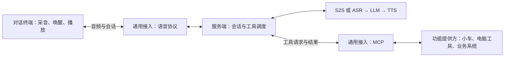

# openspeech 总体架构设计

- 更新日期为 2026-11-05。
- 已确定设备端与服务端分离、模型可替换、一语即达及第一阶段选型方向。
- 已确定对话终端与功能提供方独立接入；同一设备可同时承担两种角色。
- S2S 与串联模式的首版代码已实现。默认优先 S2S，千问实时语音闭环已验证。
- 返回[开发者设计索引](index.md)。

## 目标与约束

| 编号 | 已确定设计 | 预期结果 |
| --- | --- | --- |
| V-001 | 独立运行 | 语音平台可独立启动、停止、重启和调试 |
| V-002 | 通用接入 | Findtools 和其他项目通过统一接口使用语音及对话能力，业务动作由接入项目执行 |
| V-003 | 调试隔离 | 语音调试期间，正式 Findtools 的查询和设备操作保持可用 |
| V-004 | 联合部署 | 支持与 Findtools 一起部署，各服务分别运行 |
| V-005 | 独立项目 | openspeech 拥有自己的 Git 仓库、依赖、配置、文档和入口，与 Findtools 通过接口集成 |
| V-006 | 文档归属 | 两套语音文档库均保存在 voice 内 |
| V-007 | 设备端与服务端分离 | PC、树莓派、ESP32 可通过共同接入约定连接服务端 |
| V-008 | 模型可替换 | S2S 提供方可替换；串联模式的语音转文字、文字转语音、对话大模型分别可替换 |
| V-009 | 本地与在线模型 | 模型接口覆盖两类部署方式，首版可只实现部分提供方 |
| V-010 | 一语即达 | 唤醒词后直接连续说内容，设备完整保留并提交指令，无需等待提示或再次开口 |
| V-011 | 第一阶段 | Windows 10 系统采音、播放与本地唤醒，优先接入通义千问 S2S；保留豆包与 DeepSeek 串联路径 |
| V-012 | 目标语言与唤醒词 | 唤醒词为“小智小智”，目标覆盖带地方口音的普通话及四川话，实际效果分别验收 |
| V-013 | 双模式 | 可切换 S2S 与 ASR → LLM → TTS；设备不直接依赖云端供应商，模式按会话固定 |
| V-014 | 对话与功能分离 | 对话终端负责听说，功能提供方负责执行；两者不要求位于同一设备，允许同一设备兼具两种角色 |

## 总体架构

- 设备端作为对话终端，负责现场音频输入、唤醒、连续语音保留和回复播放。
- 服务端选择 S2S 或串联引擎；两种路径共享设备边界，供应商协议由服务端封装。
- S2S 直接输入音频、输出语音，不串联调用独立 ASR、LLM、TTS；模型可选文字输出不改变此边界。
- 通用接入分别维护对话终端的音频契约、功能提供方的工具契约。MCP 工具接入不替代实时音频接入。
- 部署与调试贯穿两端，支持同机联调和后续分机部署。
- Findtools 的货位选择、查询和亮灯由 Findtools 处理，模型业务请求的接入规则另行确定。

## 对话与功能角色

| 角色 | 职责 | 示例 |
| --- | --- | --- |
| 对话终端 | 采音、唤醒、传送语音、播放回复 | 当前 Windows 语音前端；其他终端按适配结果确认 |
| 语音平台 | 管理会话、调用模型、选择获准工具、回传实际结果 | openspeech服务端 |
| 功能提供方 | 声明工具、校验参数、执行动作并返回结果 | Windows 音量服务、Findtools；后续小车及其他电脑工具 |

- 对话终端可以只提供听说能力，功能提供方可以没有麦克风和扬声器。
- 同一台电脑或小车可以同时提供语音前端和 MCP 工具。角色独立，不要求分成两台物理设备。
- 用户可通过一个对话终端操作另一个功能提供方，不将语音输入设备默认视为操作目标。
- 功能可由设备自身或代理它的网关提供。平台按工具接口接入，实际设备控制归功能提供方。
- 两种角色沿用设备端、服务端、通用接入及部署与调试模块，不另建一套模块体系。
- Windows 语音前端和独立音量 MCP 服务已有实现。小智协议适配、小车控制及通用跨设备目标选择仍待实现或细化。

## 连接角色

| 主动连接方 | 接收方 | 通信与职责 |
| --- | --- | --- |
| 语音终端 | openspeech服务端 | 本地唤醒后建立实时语音连接。串联模式录完一段再提交 |
| openspeech服务端 | 模型提供方 | 使用对应模型接口。设备端只使用openspeech的统一接口 |
| openspeech服务端 | Windows 工具服务或外部业务系统 | 已支持 MCP Client，调用可达的 Streamable HTTP 服务。Findtools 工具待接入 |

- openspeech服务端管理对话会话、选择模型并调度工具。管理网页是同一服务的运维入口。
- 对话终端主动建立语音连接。功能提供方独立暴露工具，由openspeech服务端通过支持的 MCP 通道发现和调用。
- 同一设备兼具两种角色时，工具的身份和可用状态独立于语音会话管理。工具故障不应阻断普通对话。
- 语音两端可同机、同局域网或跨网部署。Windows 音量 MCP 服务首版仅支持同机接入，详见[通用接入](通用接入.md#工具提供方式)。

## 模块划分

| 模块 | 边界 | 设计入口 |
| --- | --- | --- |
| 设备端 | PC、树莓派、ESP32 的音频输入输出、唤醒、连续语音交互和本机工具 | [设备端](设备端.md) |
| 服务端 | S2S 与串联引擎、模型适配、会话处理和工具调度 | [服务端](服务端.md) |
| 通用接入 | 对话终端接入、会话关联、功能提供方及外部项目接入 | [通用接入](通用接入.md) |
| 部署与调试 | 各端独立运行、配置、联合部署和测试隔离 | [部署与调试](部署与调试.md) |

## 第一阶段与扩展范围

| 能力 | 第一阶段 | 后续扩展 |
| --- | --- | --- |
| 输入设备 | 当前 Windows 10 电脑的系统麦克风 | 树莓派、ESP32 等设备适配 |
| 输出设备 | Windows 默认音频输出，可通过配置指定设备编号 | 各终端扬声器或音频输出 |
| 唤醒 | 首版采用 Vosk 中文唤醒，默认“小智小智” | 按终端能力适配，统一满足一语即达 |
| 对话模式 | 默认 S2S，通义千问实时语音模型 | 更多在线或本地 S2S 适配器 |
| STT | 在线豆包语音识别 | 更多在线或本地模型 |
| LLM | DeepSeek 在线对话模型 | 更多在线或本地模型 |
| TTS | 具备统一接口并完成语音输出闭环，首版实现采用 Windows Huihui 本地语音合成 | 更多在线或本地模型 |
| 部署 | 两端可在当前电脑上独立启动联调 | 两端分机运行、与业务系统联合部署 |

表中的独立 STT、LLM、TTS 只用于串联模式；S2S 自身返回语音。实时模型不替代本地唤醒，方言效果仍需实测。

## 一语即达流程

1. 设备持续采音并检测唤醒词。
2. 用户连说“唤醒词＋内容”，例如“小智小智帮我找十字螺丝刀”。
3. 检测到唤醒后，设备保留已经说出的内容并继续收集后续语音。
4. S2S 模式在唤醒后持续发送音频，服务端转交实时模型；串联模式收齐语句后依次执行 ASR、LLM、TTS。
5. 设备播放回复。S2S 边收边播，串联模式播放完整 WAV；业务执行仍由外部项目完成。

一语即达规定唤醒词与内容可以无停顿连说。S2S 播报结束后可免唤醒追问，超时结束会话。播放时打断和双向同时说话的具体行为仍待确定。

## 验收标准

| 对应设计 | 场景 | 通过条件 |
| --- | --- | --- |
| V-001、V-005 | 单独复制 openspeech 并准备依赖 | 可独立运行各端 |
| V-002、V-003 | 接入 Findtools 或示例客户端，语音服务故障 | 接口可复用，手动业务仍可操作 |
| V-004、V-007 | 同机启动后切换服务端地址 | 设备端通过接口连接，业务与语音进程分别管理 |
| V-008、V-009 | 替换 STT、TTS 或 LLM 适配器 | 设备端和业务项目沿用共同接口；首版用模拟适配器验证扩展契约 |
| V-010 | 无停顿连说唤醒词和内容 | 内容开头完整且只处理一次，不要求等待提示 |
| V-010 | 后续树莓派和 ESP32 接入 | 分别通过连续语音用例后才标记该终端支持 |
| V-011 | Windows 10 麦克风唤醒并讲话 | 当前模式完成音频问答，由系统输出设备播放 |
| V-012 | 目标口音唤醒并连说指令 | 分别统计漏唤醒、误唤醒、触发延迟和内容识别效果；具体阈值待实测确定 |
| V-013 | 切换两种模式 | 设备自动查询服务端模式；仅检查当前模式凭据；不自动降级、不在轮次中途切换 |
| V-014 | 纯对话终端接入 | 没有设备工具仍可完成普通对话 |
| V-014 | 独立功能提供方接入 | 无需部署麦克风、唤醒或播放程序，可由对话终端发起工具操作 |
| V-014 | 同一设备兼具两种角色 | 音频和工具分别接入；工具不可用时普通对话仍可使用 |

## 待定项

- 默认唤醒词和本地引擎已实现，后续可按效果替换，其他 TTS 模型与音色偏好待定。
- 当前优先千问 S2S；串联模式保留豆包极速识别与 DeepSeek thinking。两种模式账号权限和真实效果待验证。
- 使用静音结束与单轮超时。S2S 支持播报后免唤醒追问，播报打断规则待扩展。
- 对话终端与功能提供方的身份、归属、授权及跨设备目标选择规则，延迟及效果验收指标。

## 重要设计变更

| 编号 | 日期 | 变化 | 原因 |
| --- | --- | --- | --- |
| CHG-001 | 2026-11-04 | 原音频与会话、唤醒与识别划分调整为设备端与服务端，唤醒归设备端，识别归服务端 | 支持 PC、树莓派和 ESP32 通过统一接口接入 |
| CHG-002 | 2026-11-04 | 服务端扩展 STT、TTS 和 LLM 三类可替换能力，支持在线与本地适配 | 复用对话与语音输出能力，降低后续模型替换成本 |
| CHG-003 | 2026-11-04 | 一语即达设为共同要求，确定 Windows 10、豆包 STT 和 DeepSeek 首版方向 | 明确首个端到端交互闭环 |
| CHG-004 | 2026-11-04 | 唤醒词改为“小美小美”，明确带地方口音的普通话及四川话为目标 | 按实际使用人群分别验证唤醒和内容识别 |
| CHG-005 | 2026-11-04 | 支持 S2S 与串联双模式，默认优先千问实时语音模型 | 按用户要求优先直接语音对话，保留独立模型组合能力 |
| CHG-006 | 2026-11-04 | 明确设备主动建连、服务端调度工具与业务系统接入方式 | 同一设备连接承载实时对话及本机工具下发 |
| CHG-007 | 2026-11-05 | Windows 工具服务改用标准 MCP Streamable HTTP | 统一设备和业务工具的接入方式 |
| CHG-008 | 2026-11-05 | 明确对话终端与功能提供方独立接入，同一设备允许兼具两种角色 | 复用不同语音前端，独立扩展小车、电脑工具及业务系统；总体设计已确定，扩展实现另行验收 |
| CHG-009 | 2026-11-05 | 项目命名为 openspeech，迁至桌面同名目录并解除 Findtools 子模块关系 | 独立维护代码、Git 历史和部署入口，通过 MCP 与业务系统集成 |
| CHG-010 | 2026-11-05 | 默认唤醒词改为“小智小智” | 按用户要求统一示例配置、本地配置、运行说明和模型回归样本 |

设计基线已提交为 `8a59354`。技术机制见 [AI 设计记录索引](../AI设计记录文档库/index.md)。
